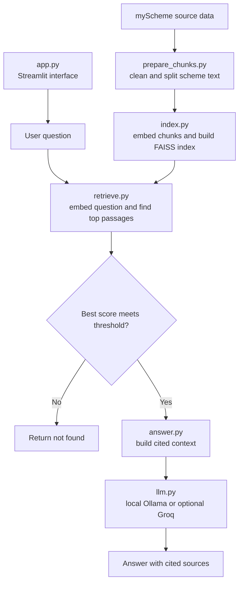

# Government Schemes RAG Assistant

## Goal

This project answers questions in English or Hindi about Indian government schemes. Idt retrieves official scheme text, uses that text to generate an answer, and cites the passages use. If the retrieved evidence is too weak or does not contain the answer, the assistant abstains instead of guessing.

## How it works



## Project pipeline

1. **Prepare data:** `prepare_chunks.py` cleans the myScheme JSONL source and creates section-level chunks in `data/chunks.json`.
2. **Build the search index:** `index.py` embeds chunks with `BAAI/bge-m3` and stores a FAISS index plus its matching chunk metadata. Index building is GPU-only; it writes resumable shards.
3. **Retrieve evidence:** `retrieve.py` embeds a question and finds the most relevant indexed passages.
4. **Check confidence and answer:** `answer.py` checks the retrieval score against the threshold in `config.yaml`, then builds a context and formats citations. Brief answers are the default; detailed mode expands sections for the strongest matching schemes when requested through `generate(detail="detailed")`.
5. **Generate locally or in the cloud:** `llm.py` uses Ollama by default. Groq is optional; cloud mode sends the question and retrieved context to Groq.
6. **Use and evaluate:** `app.py` provides the Streamlit chat UI. `evaluate.py` measures retrieval and answer behavior on the evaluation candidates.

## Run locally

Install dependencies in a Python environment:

```powershell
python -m pip install -r requirements.txt
```

Index building also requires a CUDA-enabled PyTorch install compatible with the machine's NVIDIA driver; `requirements.txt` does not install PyTorch.

### Set up GPU indexing on Windows

Create an isolated environment, then install PyTorch with CUDA support. Select **Windows**, **Pip**, **Python**, and a CUDA version supported by your NVIDIA driver on the [official PyTorch install page](https://pytorch.org/get-started/locally/) and use the generated install command. For example, for CUDA 12.8:

```powershell
py -3.12 -m venv .venv-gpu
.\.venv-gpu\Scripts\Activate.ps1
python -m pip install --upgrade pip
python -m pip install torch torchvision --index-url https://download.pytorch.org/whl/cu128
python -m pip install -r requirements.txt
```

Confirm PyTorch can see the GPU before indexing:

```powershell
python -c "import torch; print(torch.__version__); print('CUDA available:', torch.cuda.is_available()); print(torch.cuda.get_device_name(0) if torch.cuda.is_available() else 'No CUDA device')"
```

`index.py` is GPU-only and exits if CUDA is unavailable. The PyTorch selector is authoritative if the available CUDA wheel options change. See the [PyTorch installation guidance](https://docs.pytorch.org/get-started/) for selecting a CUDA-capable build.

Make sure Ollama is installed and the configured local model is available:

```powershell
ollama pull qwen3:4b-instruct-2507-q4_K_M
```

Prepare the chunks if needed, then build the FAISS index on a CUDA-enabled GPU:

```powershell
python prepare_chunks.py myscheme_data/schemes.jsonl --out data
python index.py --chunks data/chunks.json --out data/index
```

Start the app:

```powershell
streamlit run app.py
```

Local Ollama is the default. To enable Groq, set `GROQ_API_KEY` in `.env`, then select cloud mode in the app. Cloud mode sends the question and retrieved passages to Groq.

## Configuration and data

Model settings, retrieval threshold, context size, answer detail modes, and index paths are in `config.yaml`. Keep API keys in environment variables; do not commit `.env` or raw scheme data. The checked-in index is currently a small development sample; rebuild it from the intended scheme dataset for project evaluation.

Run retrieval-only evaluation without calling an LLM:

```powershell
python evaluate.py --retrieval-only
```

Use `python evaluate.py --full` to evaluate all candidates. Full answer evaluation calls the configured default LLM.
